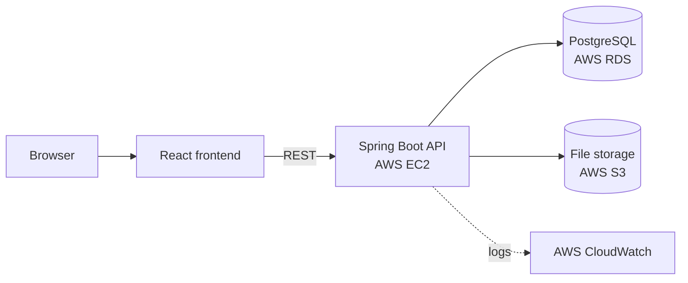

# Task Manager — Backend

REST API for a task manager with file attachments, deployed on AWS.

Frontend: [task-manager-frontend](https://github.com/IevaGurencik/task-manager-frontend)

## Tech stack

- Java 21, Spring Boot 4, Maven
- Spring Security
- Spring Data JPA / Hibernate, PostgreSQL, Flyway
- AWS SDK v2 (S3)
- JUnit 5, Mockito, MockMvc

## Architecture



## Features

- Create, view and delete tasks
- Attach multiple files to a task, download and delete them
- Storage selected by Spring profile:
  - **default** — files stored on the local file system (`upload-dir/`)
  - **prod** — files stored in S3, downloads served through presigned URLs
- Login with credentials provided via environment variables
- Database schema managed with Flyway migrations
- Global exception handling

## API

| Method | Endpoint | Description |
|---|---|---|
| POST | `/login` | Log in (Basic credentials) |
| GET | `/api/todos` | List tasks |
| GET | `/api/todos/{id}` | Get a task |
| POST | `/api/todos` | Create a task |
| DELETE | `/api/todos/{id}` | Delete a task and its files |
| GET | `/api/files` | List uploaded files |
| POST | `/api/files` | Upload files to a task (multipart: `files`, `todoId`) |
| GET | `/api/files/id/{id}` | Download a file |
| DELETE | `/api/files/id/{id}` | Delete a file |

All endpoints except `/login` require authentication.

## Running locally

**Requirements:** JDK 21, PostgreSQL

1. Create the database:
   ```bash
   createdb todos
   ```
2. Set environment variables:
   ```bash
   export ADMIN_USERNAME=<login for the app>
   export ADMIN_PASSWORD=<password for the app>
   ```
3. Run the application:
   ```bash
   ./mvnw spring-boot:run
   ```
   The API is available at http://localhost:8080. Uploaded files are saved to `upload-dir/`.

## Production (AWS)

Run with the `prod` profile:

```bash
export SPRING_PROFILES_ACTIVE=prod
```

| Variable | Purpose |
|---|---|
| `AWS_DATASOURCE_URL` | JDBC URL of the RDS PostgreSQL instance |
| `RDS_USERNAME`, `RDS_PASSWORD` | RDS credentials |
| `PROD_AWS_ACCESS_KEY`, `PROD_AWS_SECRET_KEY` | Credentials for S3 access |
| `ADMIN_USERNAME`, `ADMIN_PASSWORD` | App login |

Application logs are written to `/var/log/spring-backend/application-prod.log` and collected in CloudWatch.

## Tests

```bash
./mvnw test
```

Covers the task and file services (Mockito) and controllers (MockMvc).
